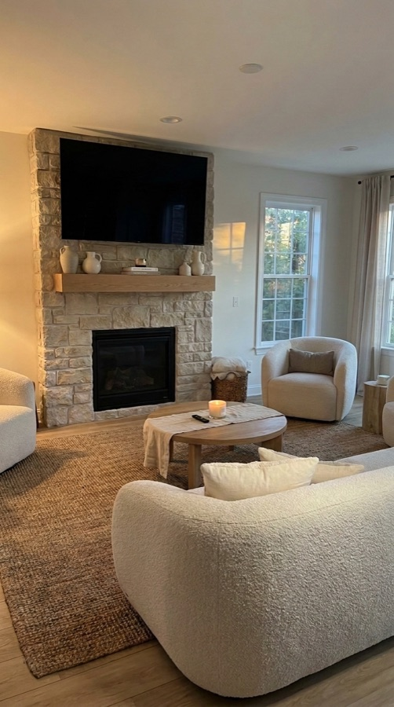
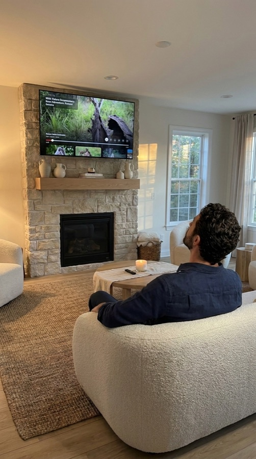

# UGC Forge

**Make the creative decisions. Let your agent handle the copy-and-paste work of AI video production.**

UGC Forge is an agent skill and Python tool for producing AI presenter clips for UGC ads and recurring creator videos. It takes the repeated work of preparing prompts, submitting each clip to an AI model, downloading the results and tracking progress out of your hands.

## Install

Paste this into Claude Code or Codex:

> Install UGC Forge by following https://raw.githubusercontent.com/indygill/ugc-forge/main/INSTALL.md

Your assistant sets everything up. The only thing you do yourself is add your API key when it asks, so the key never goes into the chat. Paste the same line again later to update. [More about setup and requirements](#get-started).

## Choosing a service

Forge works with two services. Both run the same Google models (Gemini Omni 1.1 Flash for video, Gemini 3 Pro Image for images), so the results are the same. The default is kie.ai, but the choice is yours: pick one during setup, and switch any time by running `ugc-forge setup` again.

| | kie.ai (default) | Google (direct) |
| --- | --- | --- |
| Setup | Quick sign-up; buy prepaid credits | A Google Cloud billing account and key, through Google's billing console |
| Price | Much cheaper: a 10-second 720p clip is $0.63 | A 10-second 720p clip is $1.01 |
| Speed | Slower: about 2 minutes per 4-second 720p clip in our tests | Faster: about 35 seconds per 4-second 720p clip in our tests |
| Reliability | kie.ai's own docs note its stability "may be slightly lower" than going direct | The direct source |
| Clip lengths | 4, 6, 8 or 10 seconds | Any length from 3 to 10 seconds |

In short: kie.ai is easier to set up and much cheaper for the same result, but each clip takes longer. Google is quicker and more reliable, and costs more. Speeds were measured on 2026-09-28 at 720p and will vary. See [Generation costs](#generation-costs) for full prices.

[See a real example](#the-real-output) · [Example workflow](#an-example) · [Generation costs](#generation-costs) · [Full guide](docs/workflow.md)

## How You Currently Create AI Content - The Manual Way

You find a TikTok video with the framing and setting you want. You grab a suitable frame you want to use, then ask your AI model of choice to turn the person in it into a new fictional avatar.

Now you need the idea, hook, script, exact wording and a plan for what appears on screen. You split the dialogue into short clips the video model can generate.

Then, for **every single clip**, you go back to your AI model:

1. Supply the avatar reference image.
2. Copy in the scene and performance instructions.
3. Paste that clip’s dialogue and choose its duration.
4. Submit it, wait and review the result.
5. Download it, name it, and keep track of whether it needs another attempt.
6. Repeat for the next piece of dialogue.

A two-minute video might mean **15, 20 or 30 clips**, depending on how you split it, before retakes and supporting footage. The reference and most of the instructions stay the same. You are repeatedly moving the next line of your script into the same generation process.

That is the grunt work UGC Forge is built to handle.

## What changes with Forge

Bring the reference frame to your agent. Work together on the avatar, script, wording and shot plan. Test one spoken line and refine the performance until you are happy with it.

Once you approve the setup and generation cost, Forge prepares each clip from the saved reference, approved instructions and the right piece of dialogue. It estimates the duration, submits the requests to Google's image and video models, saves numbered clips and records the results. Batch generation handles configured retries and can skip completed clips when resumed. You can also review and accept one clip at a time.

| You decide | Your agent and Forge handle |
| --- | --- |
| The idea, hook and final wording | Developing the script with you and keeping the approved dialogue in the project |
| The presenter’s appearance and performance | Building the reference request and reusing the approved reference and instructions |
| How the script should be divided and shown | Maintaining the shot plan, estimating clip lengths and flagging dialogue that does not fit |
| Whether to approve the cost and generate | Preparing and submitting the individual clip requests |
| Which performances work and what needs changing | Saving attempts, tracking acceptance and organising the source clips |

You can give feedback such as “Less movement”, “Rewrite that line” or “That take works; move on.” The agent turns those decisions into project changes and generation commands. You do not have to rebuild and paste the same request for every clip.

Forge finishes with the raw clips for your editor. You still choose the final cuts, captions, music and assembly. Forge is not a video editing suite - it is an asset creation pipeline.

## Inspired by the original tutorials

UGC Forge grew out of [this AI UGC video tutorial](https://www.youtube.com/watch?v=kvf2lRSGixg&t=1681s) and its [B-roll follow-up](https://www.youtube.com/watch?v=6rW-sH74A64). They inspired the reference-frame-to-avatar workflow behind the project. Forge packages the repeated production steps into a workflow your agent can run with you.

The tutorials show the source process. **Forge v0.9 is a prototype:** image generation, A-roll and B-roll have been run against the Google API; see [What still needs work](#what-still-needs-work).

## An example

You want to make an interiors video:

> “Why does everyone put their TV this high?”

Give your agent a reference frame and ask:

> Help me turn this idea into a short video. Create a fictional presenter called Marco using this frame for the room and framing. Let's work on the script, then test him saying the opening line before generating the rest.

Together, you refine the script and Marco’s appearance. Generate the opening line, watch it, and give feedback such as “Slower delivery, less movement.” Once you approve the test, generate the remaining lines and any additional scenes you need.

The intended handoff is a folder of clips:

```text
my-video/output/
├── a-roll/     # Marco speaking each line, with audio
└── b-roll/     # Supporting scenes featuring Marco
```

Assemble them in CapCut, Premiere Pro, DaVinci Resolve or your preferred editor. Add your cuts, supplied footage, captions and music there. For the next episode, reuse Marco and his saved setup.

### The real output

This is that episode, made with Forge on kie.ai at 720p on 2026-09-29. Marco is fictional; the opinion is the channel's own. The clips below are exactly what Forge produced, unedited: one clip per line, plus two supporting shots, ready to cut in an editor. The reference frame is licensed and not published; only the rendered images are.

| Marco (the Avatar) | B-roll image: `problem` | B-roll image: `look-up` |
| :---: | :---: | :---: |
|  |  |  |

**A-roll, one clip per line:**

1. *"Why does everyone put their TV up here?"*
   
https://github.com/user-attachments/assets/c845a68a-9f04-434b-9c62-aa4b55ba618c

2. *"You're sitting down here, and your television is halfway to the ceiling."*


https://github.com/user-attachments/assets/303459ba-fdf3-4552-b3ea-d1c87d944e75


3. *"So every evening you're basically doing this."*
   

https://github.com/user-attachments/assets/fdaab2b4-51ea-4f98-a0aa-4f35396db619


4. *"Start with where your eyes actually are when you're sitting down."*
   

https://github.com/user-attachments/assets/5770930f-c0d1-40c8-986e-b679b197e35b


5. *"Design the room for the people living in it, not the estate-agent photos."*
   

https://github.com/user-attachments/assets/9563a96a-35f2-4892-bdcc-80d7ded43293


**B-roll, to lay over lines 2 and 3:**

- `problem`: a new living room, made from a description alone; the camera moves in from the sofa to the TV high above the fireplace 

https://github.com/user-attachments/assets/8abc8c57-634e-47dc-8d86-d2f11b4a4733


- `look-up`: Marco on that sofa, seen from behind, looking up at the TV and rubbing his neck 

https://github.com/user-attachments/assets/1937bc5c-e83c-4167-8190-6a5d5298f50c


The whole run cost **$4.80** on kie.ai: two Avatar versions, one test clip, five A-roll lines and the B-roll. That includes a redo: the first B-roll images reused the A-roll room and had Marco facing the camera while looking up behind him, so the shots were remade with a new room and the camera placed behind him. The storyboard, Avatar spec and prompts are in [examples/creator-marco-tv-height](examples/creator-marco-tv-height). A [skincare ad storyboard](examples/ugc-ad-skincare/beats.json) is included as a second example.

## Speaking clips and supporting footage

The agent follows [SKILL.md](SKILL.md) for the creative workflow and uses the bundled Python tool to execute generation and manage files.

**A-roll** is the presenter speaking to camera. **B-roll** is supporting footage placed over that picture while the speech continues. Forge generates every spoken line as A-roll, including lines you plan to cover, so the edit can use its audio underneath the supporting footage.

A saved presenter is called an **Avatar**. A saved scene, outfit and reference image is a **Look**. Both can be reused; generated appearance and voice still need review for consistency.

## Get started

You need Claude Code (in a terminal, an IDE, or the Code tab of Claude Desktop) or Codex, and an account with [kie.ai](https://kie.ai) (recommended: quick sign-up, prepaid credits) or Google AI Studio (needs a Google Cloud billing account). Forge runs through your assistant; it has no separate app. It does not work in chat-only apps such as the claude.ai website, because it needs to run commands on your computer.

**Install:** paste the line from [Install](#install) into Claude Code or Codex. Your assistant installs everything it needs, then asks which service you want and has you add its API key yourself: copy the key from [kie.ai](https://kie.ai/api-key) or [Google AI Studio](https://aistudio.google.com/apikey), then type the one command your assistant gives you, such as `! ugc-forge setup --provider kie --from-clipboard` in Claude Code. The key is read from your clipboard without being shown; never paste it into the chat. Start a new session afterwards so the skill loads.

<details>
<summary>Other ways to install</summary>

**As a Claude Code plugin.** In Claude Code, run:

```
/plugin marketplace add indygill/ugc-forge
/plugin install ugc-forge@ugc-forge
```

Then ask Claude to set up UGC Forge; the skill installs the `ugc-forge` command it needs.

**By hand.** Install [uv](https://docs.astral.sh/uv/), then run:

```bash
uv tool install --force --refresh https://github.com/indygill/ugc-forge/archive/refs/heads/main.zip
ugc-forge install-skill
ugc-forge setup
```

</details>

See [Choosing a service](#choosing-a-service) for how kie.ai and Google compare. With Google, simple B-roll image edits can also use the cheaper `gemini-3.1-flash-image`. Other models are refused: they need different code.

Advanced: a project's own `config.yaml` can set its own `api_key`, or name an environment variable in `api_key_env`. `.env` files are not loaded.

Create a project folder:

```bash
ugc-forge init my-video
```

Then give your assistant the project and reference frame, with a request such as:

> Read SKILL.md in this repository and help me create a video in my-video. My idea is “Why does everyone put their TV this high?” Help me develop the script and a fictional presenter called Marco. Use this frame as the visual reference. Start with the creative plan and let me review it before generating anything.

The assistant should help prepare the project files before running generation commands. Initialising the folder alone does not create a finished script or ready-to-generate presenter.

See the [workflow guide](docs/workflow.md) for the detailed steps, command examples, reusable presenters and series setup. Example storyboards are available for [a skincare ad](examples/ugc-ad-skincare/beats.json) and [Marco’s interiors video](examples/creator-marco-tv-height/beats.json).

## Generation costs

Image and video generation use paid APIs. The workflow asks for approval before chargeable generation, including test clips. Regenerating a clip can add cost.

Price per video clip, with audio:

| Resolution | kie.ai 4s | kie.ai 10s | Google 4s | Google 10s |
| --- | ---: | ---: | ---: | ---: |
| 360p | $0.32 | $0.63 | $0.14 | $0.34 |
| 720p (recommended) | $0.32 | $0.63 | $0.41 | $1.01 |
| 1080p | $0.32 | $0.63 | $0.61 | $1.52 |
| 4K | $0.74 | $1.05 | $1.22 | $3.04 |

Google bills per second, so any length from 3 to 10 seconds is priced proportionally; kie.ai charges per clip of 4, 6, 8 or 10 seconds, and its 360p costs the same as 720p (so on kie.ai, test at 720p).

Google makes 1080p and 4K by upscaling. In our test, 720p upscaled to 1080p was visually indistinguishable from Google's 1080p, so produce at 720p and upscale in your editor. 360p suits early test clips.

Images cost about $0.09 each on kie.ai, or from Google about $0.13 with `gemini-3-pro-image` or $0.07 with `gemini-3.1-flash-image`.

For example, three 10-second clips at 720p cost about **$1.89** on kie.ai or **$3.04** on Google, plus test clips, images and any regenerations. `ugc-forge status` shows the spend so far, and `costs.json` in each project breaks it down.

Google figures use its prices on 2026-09-24: $17.50 per million video output tokens and $120 (pro) or $60 (flash) per million image output tokens; input and text-output charges are small and not included. kie.ai figures use its listed prices on 2026-09-28 at $0.005 per credit; its 360p and image prices aren't published and were measured on 2026-09-28. For kie.ai, Forge records the credits each job actually used. Sources: [Gemini API pricing](https://ai.google.dev/gemini-api/docs/pricing) and [Google Cloud resolution token rates](https://cloud.google.com/gemini-enterprise-agent-platform/generative-ai/pricing).

If a run is interrupted, running the same command again collects clips already paid for instead of paying again.

See [config.example.yaml](config.example.yaml) for settings. Existing projects retain any explicit pricing overrides in their own config. Estimates are not provider invoices.

## What still needs work

The local workflow includes project storage, saved presenters and setups, dialogue timing, cost estimates, a test-and-approve stage, batch or individual clip generation, and an initial supporting-footage workflow.

Image generation, A-roll (test clips, batch and resume after an interruption) and B-roll have been run against the live API. One-at-a-time generation and the Avatar/Look library are covered by local tests but have not yet been run end to end with paid generation. A recorded demo is still needed.

You supply the reference material and review the creative results. Forge does not source or download social-media references. It also leaves final assembly, captions, music, graphics and transitions to your editor. Existing supporting footage can be recorded in the storyboard; Forge generates supporting scenes with or without the saved presenter.

## Contributing

Contributions are welcome, especially live provider verification, generation reliability and clearer setup instructions. The [workflow guide](docs/workflow.md) contains the longer examples and design notes.

Released under the Apache License 2.0. See [LICENSE](LICENSE).
